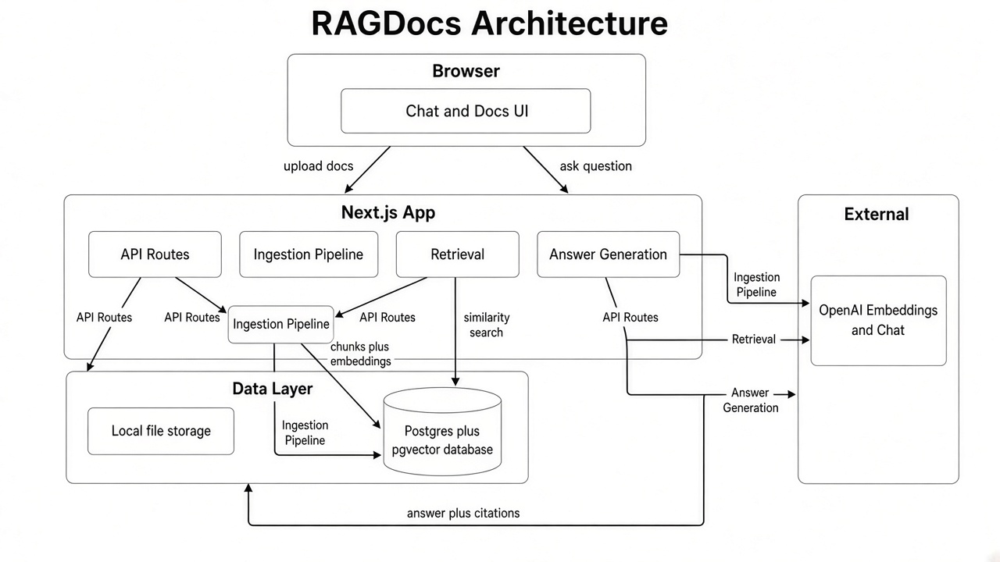
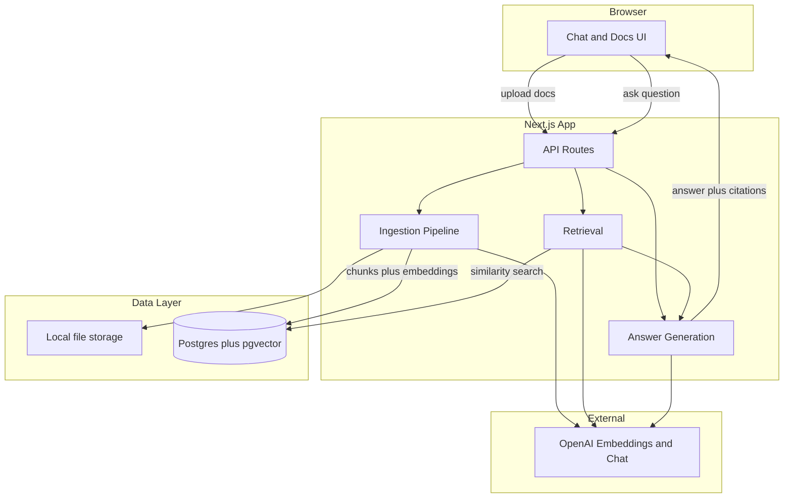

# RAGDocs architecture

RAGDocs is a TypeScript documentation assistant with an explicit retrieve-then-generate pipeline. Stages stay in focused modules rather than behind a heavy RAG framework.

## 1. Architecture





## Pipeline

```text
Upload (.md / .txt)
        │
        ▼
Parse → chunk → embed (text-embedding-3-small)
        │
        ▼
Postgres + pgvector (documents, chunks, HNSW cosine)
        │
        ▼
Question → embed query → top-k cosine similarity
        │
        ├── best score < minScore (0.3) → refusal (no chat LLM)
        │
        └── grounded → prompt with numbered chunks → stream chat answer + citations
```

## Modules

| Area | Location | Responsibility |
| --- | --- | --- |
| Schema / DB | `src/lib/db/` | Drizzle models, Postgres client |
| Ingest | `src/lib/documents/` | Validate, store uploads, parse, orchestrate index |
| Chunk / embed / retrieve / prompt / generate | `src/lib/rag/` | Core RAG stages |
| Chat persistence | `src/lib/chat/` | Conversations, messages, answer orchestration |
| Hardening | `src/lib/security/`, `src/lib/http/`, `src/lib/openai/retry.ts` | Rate limits, body caps, public errors, retries |
| UI | `src/app/`, `src/components/` | Documents, retrieve debugger, grounded chat |

## Grounding rule

Retrieval returns a cosine similarity score per chunk (`1 - distance`). The result set is **grounded** when the best score is ≥ `minScore` (default `0.3`). Chat refuses with a fixed message when not grounded and does not call the chat model.

## APIs

| Route | Role |
| --- | --- |
| `POST /api/documents` | Upload + ingest |
| `GET /api/documents`, `GET/DELETE /api/documents/[id]` | Manage docs |
| `POST /api/retrieve` | Debug similarity search |
| `POST /api/chat` | SSE: `meta` → `token`/`refusal` → `done` |
| `GET /api/health` | Database connectivity |

## Data model

- **documents** — metadata + status (`processing` / `ready` / `failed`)
- **chunks** — text + `vector(1536)` + heading path + HNSW index
- **conversations** / **messages** — chat turns; assistant rows may store `citations_json`

## Hardening notes

- Per-IP in-memory rate limits on chat, retrieve, and upload (single process)
- JSON bodies capped at 32 KB; uploads at 2 MB
- OpenAI calls retry transient 429/5xx with backoff
- API errors return stable `{ error, code }` without stack traces

## Eval

See `fixtures/eval/golden-set.json` and `npm run eval:retrieval` for retrieval regression checks against the sample Payments API guide.
